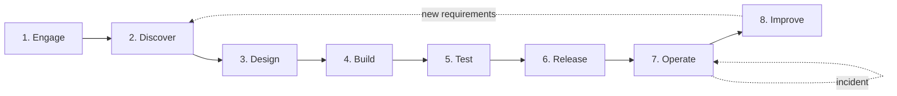
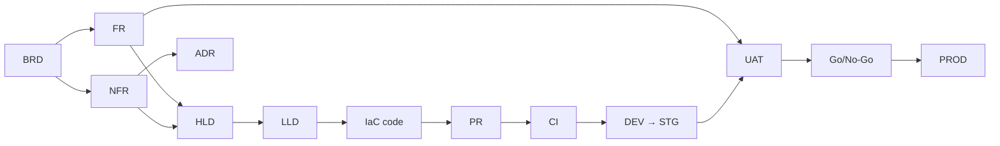
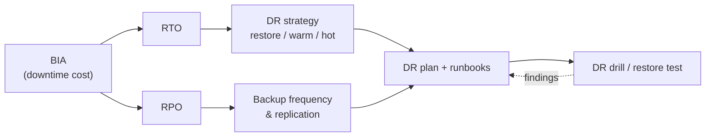
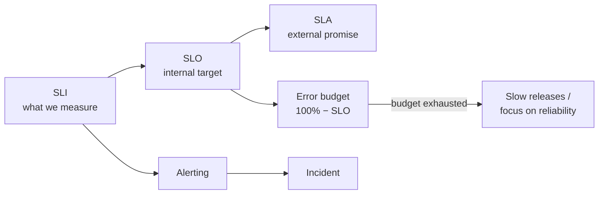
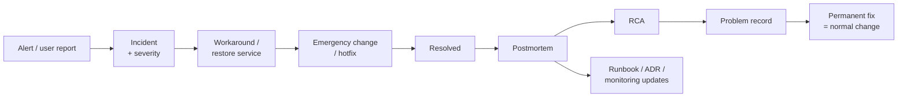
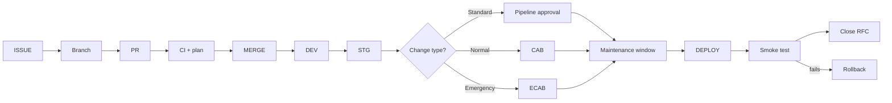

# Lifecycle and Term Chains — How the Terms Connect

The [glossary](glossary.md) explains terms one by one. This page shows **when they appear,
who uses them, and how they connect** — across the project lifecycle, in chains of
dependent concepts, and in normal operation versus an incident.

Examples use the fictional **Example Corp** (25 staff, one office, Proxmox + OPNsense +
WireGuard + Tailscale + Cloudflare), the case in [`sa-case-studies`](https://github.com/fridayn8/sa-case-studies).

## 1. The lifecycle at a glance

| Stage | Goal | Key activities | Artifacts | Key terms | Main people |
|-------|------|----------------|-----------|-----------|-------------|
| **1. Engage** | Understand the opportunity, agree on scope | Answer RFI/RFP, estimate, propose | Proposal, BoM, SOW | RFI, RFP, RFQ, SOW, BoM, TCO, ROI, CAPEX/OPEX | Sales, architect, customer |
| **2. Discover** | Understand needs and current state | Workshops, interviews, as-is assessment | BRD, FR/NFR list, as-is docs, risk register | Stakeholder, BRD, FR, NFR, Constraint, Assumption, As-is, BIA, RACI | Business analyst, architect |
| **3. Design** | Decide *how* to meet the needs | Options, trade-offs, PoCs, reviews | HLD, LLD, ADRs, diagrams, threat model, capacity plan | HLD, LLD, ADR, C4, PoC, Trade-off, SPOF, HA, RTO/RPO, STRIDE, ARB | Architect, security, ops |
| **4. Build** | Implement the design | IaC, configuration, pipelines | Code, golden images, pipelines, runbooks | IaC, GitOps, Idempotent, Golden image, CI, PR, Branch | Engineers |
| **5. Test** | Prove it works and meets NFRs | Functional, integration, performance, security, DR tests | Test results, UAT sign-off | DEV/SIT/QA/UAT/STG, Regression, UAT, Pen test, DR drill | QA, business users, security |
| **6. Release** | Put it into production safely | Change approval, cutover, smoke test | RFC, cutover plan, release notes, tag | RFC, CAB, Go/No-Go, Maintenance window, Cutover, Blue-green, Rollback, SemVer | Release manager, ops |
| **7. Operate** | Keep it running and secure | Monitoring, patching, backups, incidents | Dashboards, alerts, incident tickets | SLA/SLO/SLI, Monitoring, Incident, Severity, On-call, Runbook, Backup, Drift | Ops, SRE, helpdesk |
| **8. Improve** | Learn and evolve | Postmortems, RCA, capacity reviews, roadmap | Postmortem, problem records, new ADRs | Postmortem, RCA, Problem, Error budget, Technical debt, DORA, FinOps | Everyone |

## 2. Term chains — how concepts depend on each other

### 2.1 From business need to running code (traceability)

Every production element should be traceable back to a requirement — and every requirement
forward to a design element and a test. Reviewers ask: *"Which requirement does this serve?"*

### 2.2 Reliability chain: from business impact to backups

Example: BIA says the internal web app costs USD 500/hour when down → RTO 4 h, RPO 24 h →
nightly Proxmox backups + off-site copy are enough; a second server (HA) is not justified.

### 2.3 Service levels

### 2.4 Incident → improvement

### 2.5 Change → production

## 3. Normal operation vs. incident — what changes?

| Aspect | Normal operation (BAU) | Incident / emergency |
|--------|------------------------|----------------------|
| Goal | Deliver value safely | **Restore service first**, find root cause later |
| Change type | Standard / normal change | Emergency change (ECAB) |
| Git flow | Feature branch → PR → review → merge | `hotfix/*` (or `fix/*`) from production → fast review → merge |
| Approval | CAB or automated pipeline | ECAB / incident commander; documented afterwards |
| Timing | Maintenance window, respect freeze | Immediately |
| Testing | Full pipeline, UAT | Minimal targeted test + smoke test |
| Communication | Release notes, change calendar | Status page, incident channel, regular updates to stakeholders |
| Access | Normal paths (SSO, Tailscale) | Break-glass if normal paths are down |
| Documentation | PR, RFC, ADR | Incident timeline → postmortem → RCA → problem record |
| Manual changes | Not allowed (IaC only) | Allowed if necessary, **must be codified afterwards** (avoid drift) |
| Metrics | DORA, SLO compliance | MTTD, MTTR, impact, error budget burn |

## 4. Scenarios

The six worked scenarios (new project, normal change, incident, security incident, disaster and
planned major change) are part of the Example Corp case and live in
[`sa-case-studies`](https://github.com/fridayn8/sa-case-studies/tree/main/case-01-example-corp/scenarios).

## 5. Quick lookup: "I am in this situation — which terms matter?"

| Situation | Terms to know |
|-----------|---------------|
| Customer asks for a proposal | RFI, RFP, SOW, BoM, TCO, CAPEX/OPEX, Assumption |
| Starting a project | Stakeholder, RACI, BRD, FR, NFR, Constraint, As-is/To-be |
| Choosing between technologies | Trade-off, ADR, PoC, TCO, NFR |
| Writing the design | HLD, LLD, C4, SPOF, HA, Threat model, Capacity planning |
| Defining reliability targets | BIA, RTO, RPO, SLA/SLO/SLI, Availability |
| Building infrastructure | IaC, GitOps, Idempotent, Golden image, State, Drift |
| Testing and acceptance | DEV/SIT/QA/UAT/STG, Regression, Smoke test, Sign-off |
| Releasing to production | RFC, CAB, Change types, Maintenance window, Go/No-Go, Cutover, Rollback, Blue-green/Canary |
| Something is broken | Incident, Severity, Workaround, Escalation, Runbook, Emergency change, Hotfix, MTTR |
| After an outage | Postmortem, RCA, Problem, Known error, Action items |
| Site/server destroyed or ransomware | DR, DRP, BCP, RTO, RPO, Backup 3-2-1, Failover |
| Handing over to operations | As-built, Handover, Runbook, Hypercare, BAU |
| Controlling cost | TCO, FinOps, Capacity planning, Headroom |
| Security review | CIA, AAA, Zero Trust, PoLP, Segmentation, Defense in depth, STRIDE |
