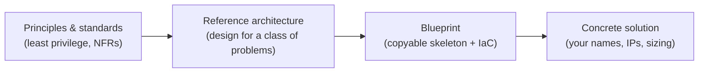

# Reference Architectures & Blueprints

Deep dive for [Top 10 activity #5](solution-architect-top10.md#5-reference-architectures--blueprints).
This page is written in small parts; each part stands on its own.

**Parts:** [1. What it is](#1-what-it-is) · more parts are listed in the [BACKLOG](../BACKLOG.md).

---

## 1. What it is

A **reference architecture** is a reusable, opinionated design for a *class* of problems
("a secure small-office network", "a static site with a serverless API"). It records the
decisions you do not want to re-debate on every project: components, boundaries, default
security controls, and the trade-offs you accepted.

A **blueprint** is the working form of that design: a folder you can copy and start from, with
a README, a diagram, and (when it makes sense) IaC modules and configuration defaults.

Short version: the reference architecture is the **idea**, the blueprint is the **starter kit**.

### Where it sits

Each step to the right adds detail and removes freedom. Stay at the level that fits the
audience: a manager reads the reference architecture, an engineer starts from the blueprint.

### How it differs from nearby terms

| Term | What it is | Compared with a reference architecture |
|------|------------|----------------------------------------|
| **Design pattern** | A solution to one recurring design problem (for example a queue between two services) | Smaller. A reference architecture combines several patterns |
| **Landing zone** | A pre-configured, governed cloud account/network setup | One kind of reference architecture, focused on the cloud foundation |
| **Golden image** | A hardened machine image used as the starting point for servers | One building block that a blueprint can use |
| **HLD** | The design of *one specific* solution | Concrete. A reference architecture is the generic form the HLD can start from |
| **Enterprise architecture (EA)** | Organisation-wide structure and strategy | Wider. A reference architecture is one of EA's reusable outputs |

### Why bother

- **Speed:** a team starts from a proven baseline instead of a blank page.
- **Consistency:** security, networking and observability are done the same way every time.
- **Leverage:** one architect's decisions are reused by many teams.
- **Review:** a deviation from the blueprint is easy to spot and has to be justified (write an
  [ADR](../templates/adr-template.md)).

### When *not* to use one

- The problem is genuinely new and you do not yet know what "good" looks like. Build a
  [PoC](solution-architect-top10.md#10-proofs-of-concept-poc--spikes) first.
- Only one team will ever build it once. A normal [HLD](../templates/hld-template.md) is enough.
- The blueprint has no owner. An unmaintained blueprint drifts and teaches bad habits.

### Related glossary terms

[Reference architecture / Blueprint](glossary.md#reference-architecture--blueprint),
[Golden image](glossary.md#golden-image--template), [IaC](glossary.md#iac--infrastructure-as-code),
[EA](glossary.md#ea--enterprise-architecture).
