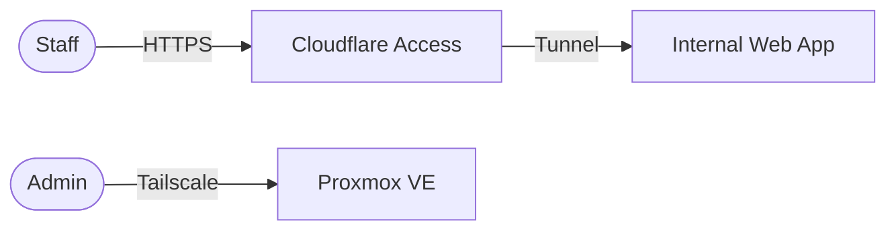

# Top 10 Solution Architect Activities You Can Keep in Git

A Solution Architect turns business needs into a technical solution that is **feasible,
secure, cost-effective and operable** — and then makes sure the team can build it.
Most of that work produces *artifacts*. When those artifacts live in Git, they become
**versioned, reviewable, searchable and automatable**.

This page lists the ten most common activities, what they produce, which tools to use,
and **where to practise it** (worked examples live in the companion repositories
[`sa-case-studies`](https://github.com/fridayn8/sa-case-studies) and [`sa-projects`](https://github.com/fridayn8/sa-projects)).

## Overview

| # | Activity | Artifact | Typical tools | Practise it |
|---|----------|----------|---------------|--------------|
| 1 | [Architecture Decision Records](#1-architecture-decision-records-adr) | `adr/NNNN-*.md` | MADR, adr-tools, Log4brains | [ADR log](https://github.com/fridayn8/sa-case-studies/tree/main/case-01-example-corp/02-options-decisions/adr), [template](../templates/adr-template.md) |
| 2 | [Diagrams as code](#2-diagrams-as-code) | `.md` with Mermaid, `.dsl`, `.puml` | Mermaid, PlantUML/C4-PlantUML, Structurizr | [Example Corp diagrams](https://github.com/fridayn8/sa-case-studies/tree/main/case-01-example-corp/03-design) |
| 3 | [Solution design documents (HLD/LLD)](#3-solution-design-documents-hld--lld) | `design/*.md` | Markdown, MkDocs | [Example Corp HLD/LLD](https://github.com/fridayn8/sa-case-studies/tree/main/case-01-example-corp/03-design), [HLD template](../templates/hld-template.md) |
| 4 | [Infrastructure as Code](#4-infrastructure-as-code-iac) | `.tf`, Ansible YAML (`.pkr.hcl` with Packer) | OpenTofu/Terraform, Packer, Ansible, Pulumi | [`sa-projects`](https://github.com/fridayn8/sa-projects) |
| 5 | [Reference architectures & blueprints](#5-reference-architectures--blueprints) | Template folders + README | Cookiecutter, Terraform modules | Not covered yet — see [BACKLOG](../BACKLOG.md) |
| 6 | [API & integration contracts](#6-api--integration-contracts) | `openapi.yaml`, `asyncapi.yaml`, `.proto` | OpenAPI, AsyncAPI, Spectral | Not covered yet — see [BACKLOG](../BACKLOG.md) |
| 7 | [CI/CD pipeline templates](#7-cicd-pipeline-templates) | `.github/workflows/*.yml` | GitHub Actions, ArgoCD | [PR and issue templates](../.github/), [`sa-projects` roadmap](https://github.com/fridayn8/sa-projects/blob/main/ROADMAP.md) |
| 8 | [Security & compliance artifacts](#8-security--compliance-artifacts) | Threat model, policies | STRIDE, OPA, Checkov, gitleaks | [Example Corp threat model](https://github.com/fridayn8/sa-case-studies/tree/main/case-01-example-corp/04-security-cost), [template](../templates/threat-model-template.md) |
| 9 | [Cost estimation & capacity planning](#9-cost-estimation--capacity-planning) | `cost/*.md` | Infracost, cloud calculators | [Example Corp cost and capacity](https://github.com/fridayn8/sa-case-studies/tree/main/case-01-example-corp/04-security-cost) |
| 10 | [Proofs of Concept (PoC) & spikes](#10-proofs-of-concept-poc--spikes) | `poc/<name>/` + findings | Docker Compose, any language | Not covered yet — see [BACKLOG](../BACKLOG.md) |

---

## 1. Architecture Decision Records (ADR)

**What:** A short document that records *one* significant decision: the context, the options
considered, the decision, and its consequences.

**Why it matters:** Code shows *what* was built; ADRs explain *why*. They prevent the same
debate from happening again and help new team members understand the system.

**When to write one:** when a decision is hard to reverse, affects several teams/components,
or had real alternatives (e.g. "Proxmox vs ESXi", "Tailscale vs plain WireGuard").

**Good practice:**

- One decision per file, numbered sequentially: `0002-hypervisor-proxmox.md`.
- Status lifecycle: `Proposed → Accepted → (Deprecated | Superseded by ADR-NNNN)`.
- Never rewrite an accepted ADR — supersede it with a new one.
- Propose ADRs via pull request, so the discussion is captured in review comments.

**Example (short):**

```markdown
# ADR-0005: Use Cloudflare Tunnel for public ingress
Status: Accepted
## Context
We must publish two internal web apps without opening inbound firewall ports.
## Options
1. Port-forward 443 on OPNsense to a reverse proxy
2. Cloudflare Tunnel (outbound-only connector)
3. VPS reverse proxy + WireGuard back to office
## Decision
Option 2 — no inbound ports, built-in WAF/Access, free tier sufficient.
## Consequences
+ Smaller attack surface  − Dependency on Cloudflare availability
```

**Practise it:** start from the [ADR template](../templates/adr-template.md); see the [Example Corp ADR log](https://github.com/fridayn8/sa-case-studies/tree/main/case-01-example-corp/02-options-decisions/adr).

---

## 2. Diagrams as code

**What:** Architecture diagrams written as text (Mermaid, PlantUML, Structurizr DSL) instead
of binary files from a drawing tool.

**Why it matters:** Text diagrams can be diffed, reviewed in PRs, and kept next to the code they
describe. GitHub renders Mermaid natively.

**The C4 model** (by Simon Brown) gives four zoom levels:

| Level | Shows | Audience |
|-------|-------|----------|
| 1. System Context | The system, its users and external systems | Everyone, incl. business |
| 2. Container | Applications, databases, services inside the system | Architects, developers, ops |
| 3. Component | Major building blocks inside one container | Developers |
| 4. Code | Classes / functions (rarely drawn by hand) | Developers |

**Example (Mermaid):**



**Practise it:** [Example Corp diagrams](https://github.com/fridayn8/sa-case-studies/tree/main/case-01-example-corp/03-design).

---

## 3. Solution design documents (HLD / LLD)

**What:**

- **HLD (High-Level Design):** the big picture — scope, context, main components, how they
  interact, key decisions, how non-functional requirements (NFRs) are met.
- **LLD (Low-Level Design):** implementation details — IP plans, VLANs, firewall rules,
  VM sizing, naming conventions, configuration parameters.

**Why it matters:** It is the contract between business, architecture and the build team.
Writing it forces you to discover gaps *before* anything is built.

**Typical HLD outline:**

1. Purpose & scope
2. Business requirements & NFRs (availability, performance, security, scalability, cost)
3. Assumptions & constraints
4. Architecture overview (context + container diagrams)
5. Component descriptions
6. Data & traffic flows
7. Security architecture
8. Operations (monitoring, backup, DR)
9. Risks & open issues
10. Related ADRs

**Practise it:** [HLD template](../templates/hld-template.md), [LLD template](../templates/lld-template.md); worked example in [Example Corp design](https://github.com/fridayn8/sa-case-studies/tree/main/case-01-example-corp/03-design).

---

## 4. Infrastructure as Code (IaC)

**What:** Infrastructure (VMs, networks, DNS, firewall rules, access policies) defined in
code and applied by tools.

| Tool | Role | Used here for |
|------|------|---------------|
| **OpenTofu / Terraform** | Declares *what* resources should exist (provisioning) | Proxmox VMs, Cloudflare DNS/Tunnel/Access, Tailscale (with OpenTofu) |
| **Packer** | Builds machine images / templates | Not used — replaced by official cloud images (ADR-0012) |
| **Ansible** | Configures *inside* machines (configuration management) | OPNsense, WireGuard, Linux hardening |

**Why it matters:** Repeatable, reviewable, auditable infrastructure. The architect's design
becomes an executable **reference implementation**.

**Key concepts:** state, plan vs apply, drift, idempotency, modules, remote backend.

**Practise it:** [`sa-projects`](https://github.com/fridayn8/sa-projects) (OpenTofu and Ansible).

---

## 5. Reference architectures & blueprints

**What:** Reusable, opinionated patterns ("this is how we build X here") with a working skeleton.
Examples: *secure SMB office*, *event-driven microservices*, *static site + serverless API*.

**Why it matters:** Teams start from a proven baseline instead of reinventing security,
networking and observability every time. Architects scale their impact this way.

**A blueprint usually contains:** a README (problem, when to use, when *not* to use),
diagram, IaC modules, default security controls, and known trade-offs.

**Deep dive:** [Reference architectures & blueprints](reference-architectures.md) (written in
parts; more in the [BACKLOG](../BACKLOG.md)).

**Practise it:** not covered yet — see [BACKLOG](../BACKLOG.md).

---

## 6. API & integration contracts

**What:** Machine-readable specifications of how systems talk to each other.

| Style | Specification |
|-------|---------------|
| REST / HTTP | OpenAPI 3.1 |
| Events / messaging (Kafka, MQTT, AMQP) | AsyncAPI |
| gRPC | Protocol Buffers (`.proto`) |
| GraphQL | GraphQL SDL |

**Why it matters:** *Contract-first* design lets teams work in parallel, generate clients and
mocks, and catch breaking changes in CI (e.g. with Spectral or `oasdiff`).

**Practise it:** not covered yet — see [BACKLOG](../BACKLOG.md).

---

## 7. CI/CD pipeline templates

**What:** Automated pipelines that lint, test, scan, plan and deploy.

**Why it matters:** Architects define *quality gates* — what must be true before something
reaches production. Pipelines enforce those gates consistently.

**Typical IaC pipeline:**

```text
PR opened → fmt/lint → security scan (Checkov, gitleaks) → tofu plan
          → plan posted as PR comment → review → merge → tofu apply
```

**Practise it:** [PR and issue templates](../.github/) here; pipelines in the [`sa-projects` roadmap](https://github.com/fridayn8/sa-projects/blob/main/ROADMAP.md).

---

## 8. Security & compliance artifacts

**What:**

- **Threat model** — what can go wrong, using STRIDE
  (Spoofing, Tampering, Repudiation, Information disclosure, Denial of service, Elevation of privilege).
- **Policy as code** — rules checked automatically (OPA/Rego, Checkov, Tailscale ACLs).
- **Secrets management** — how secrets are stored, encrypted and rotated (SOPS + age).
- **Hardening baselines** — checklists per component.

**Why it matters:** Security is designed in, not bolted on. Auditors and security teams
can review it in Git.

**Practise it:** [threat model template](../templates/threat-model-template.md); worked example in [Example Corp security and cost](https://github.com/fridayn8/sa-case-studies/tree/main/case-01-example-corp/04-security-cost).

---

## 9. Cost estimation & capacity planning

**What:**

- **Capacity planning** — CPU, RAM, storage, network sizing with headroom and growth.
- **Cost estimate** — CAPEX (hardware) and OPEX (power, licences, SaaS tiers, cloud usage).
- **FinOps in CI** — Infracost comments the cost impact of each Terraform PR.

**Why it matters:** A design that the business cannot afford is not a solution.

**Practise it:** [Example Corp cost and capacity](https://github.com/fridayn8/sa-case-studies/tree/main/case-01-example-corp/04-security-cost). Infracost prices public clouds only, so the free-only Example Corp stack uses a plain TCO table instead ([ADR-0010](https://github.com/fridayn8/sa-case-studies/blob/main/case-01-example-corp/02-options-decisions/adr/0010-free-only-tooling-policy.md)).

---

## 10. Proofs of Concept (PoC) & spikes

**What:** Small, time-boxed experiments that answer *one* question
("Can Cloudflare Tunnel handle our upload sizes?", "What is the WireGuard throughput on this NIC?").

**Why it matters:** Reduces risk before committing to a design. Evidence beats opinion.

**A good PoC folder contains:**

```text
poc/cloudflare-tunnel-vs-portforward/
├── README.md      # question, hypothesis, setup, results, conclusion, link to ADR
├── docker-compose.yml
└── results/       # benchmark output, screenshots
```

**Rule:** a PoC is throw-away code. Its *findings* feed an ADR; its code does not go to production.

**Practise it:** not covered yet — see [BACKLOG](../BACKLOG.md).

---

## Bonus: GitHub features architects use daily

| Feature | Use |
|---------|-----|
| `README.md` / `CONTRIBUTING.md` | Explain the repo and how to work in it |
| Issue & PR templates | Built-in checklists (ADR needed? NFRs met? secrets?) |
| `CODEOWNERS` | Mandatory review by owners of critical paths |
| Branch rulesets | Protect `main`, require PRs and green CI (private repos: needs a paid plan) |
| GitHub Projects & Milestones | Roadmaps, technical debt tracking |
| GitHub Pages + MkDocs | Publish the architecture docs as a website |
| Discussions | Early-stage architecture conversations before an ADR |
