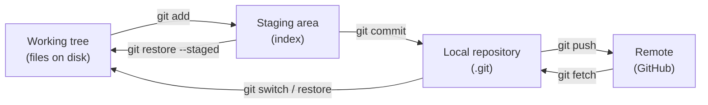

# 00 — Core Concepts (the mental model)

Most Git confusion disappears once you understand **where your changes live** and
**what a branch really is**.

## 1. The three areas (+ remote)



| Area | What it is | See it with |
|------|-----------|-------------|
| **Working tree** | The files you edit | `git status`, `git diff` |
| **Staging area (index)** | A draft of the next commit | `git diff --staged` |
| **Local repository** | All commits, stored in `.git/` | `git log` |
| **Remote** | Another copy of the repo (e.g. on GitHub) | `git log origin/main`, `git remote -v` |

**Why a staging area?** It lets you commit *part* of your changes — e.g. only the firewall
rule fix, not the unrelated typo — keeping each commit focused.

## 2. Commits

A commit is a **snapshot** of the whole project at a moment, plus metadata:

- a unique ID (SHA-1 hash, e.g. `83115ef…`; the first 7 characters are usually enough)
- author, date, message
- pointer(s) to its **parent** commit(s)

Commits form a chain (actually a graph). They are **immutable**: "changing" a commit
(amend, rebase) really creates a *new* commit with a new SHA.

## 3. Branches and HEAD

- A **branch** is just a movable **label pointing to a commit**. Creating one is instant and cheap.
- **HEAD** is "where you are now" — normally it points to a branch.
- When you commit, the current branch label moves forward to the new commit.

```text
          A---B---C   ← main
                   \
                    D---E   ← feat/vlan   ← HEAD
```

- **Detached HEAD**: HEAD points directly at a commit, not a branch (e.g. after
  `git switch --detach v1.0.0`). New commits there belong to no branch — create one with
  `git switch -c <name>` if you want to keep them.

## 4. Remotes and remote-tracking branches

- `origin` is the default name for the remote you cloned from.
- `origin/main` is a **remote-tracking branch**: your local, read-only memory of where
  `main` was on `origin` the last time you fetched.
- `git fetch` updates `origin/*`. It never touches your own branches.
- `git pull` = `git fetch` + integrate (merge or rebase) into your current branch.
- **Upstream**: the remote branch your local branch tracks (set with `git push -u`).
  Enables plain `git pull` / `git push` and "ahead/behind" counts.

## 5. Merge vs rebase (at a glance)

```text
Before:          A---B---C  main
                      \
                       D---E  feature

Merge:           A---B---C-------M  main      (M = merge commit, history preserved)
                      \         /
                       D-------E

Rebase:          A---B---C---D'---E'  feature  (D', E' are NEW commits; linear history)
```

Details: [03](03-branching-merging.md) and [07](07-rebase-and-history.md).

## 6. Relative references

| Syntax | Meaning |
|--------|---------|
| `HEAD` | Current commit |
| `HEAD~1` / `HEAD~` | Parent of HEAD |
| `HEAD~3` | Three commits back (following first parents) |
| `HEAD^2` | Second parent of a merge commit |
| `main@{1}` | Where `main` pointed before its last move (from reflog) |
| `@{u}` | Upstream of the current branch (e.g. `origin/main`) |
| `A..B` | Commits reachable from B but not from A ("what's in B that A lacks") |
| `A...B` | Commits in either A or B but not both |

## 7. What is inside `.git/`?

| Path | Content |
|------|---------|
| `.git/objects/` | All content (blobs, trees, commits), compressed |
| `.git/refs/heads/` | Your branches (each is a file with a SHA) |
| `.git/refs/remotes/` | Remote-tracking branches |
| `.git/HEAD` | What HEAD points to |
| `.git/config` | Repo-level configuration |
| `.git/hooks/` | Scripts run on events (pre-commit, commit-msg…) |

Try it: `cat .git/HEAD` and `cat .git/refs/heads/main`.
