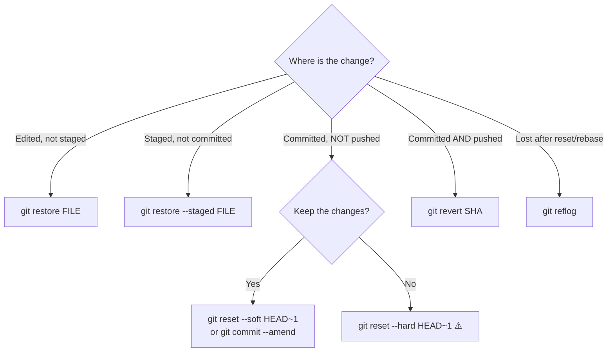

# 05 — Undo and Recovery

## Decision guide



## git restore

**Purpose:** Restore files in the working tree or staging area.
**Risk level:** ⚠️ discarding working-tree changes is permanent (they were never committed)

**Basic**

```bash
git restore README.md              # discard unstaged changes in a file
git restore .                      # ⚠️ discard all unstaged changes
git restore --staged README.md     # unstage (keep the edits)
```

**Advanced**

```bash
git restore --source=HEAD~2 config.yml       # file content from 2 commits ago
git restore --source=main -- docs/hld.md     # take file from another branch
git restore --staged --worktree file.md      # unstage AND discard
git restore -p file.md                       # interactively pick hunks to discard
```

Classic equivalents: `git checkout -- <file>` and `git reset HEAD <file>`.

## git commit --amend

**Purpose:** Replace the most recent commit (fix message, add forgotten file).
**Risk level:** ✅ if not pushed · 🔥 if already pushed (requires force push)

```bash
git commit --amend -m "fix(dns): correct upstream resolver"   # new message
git add forgotten.tf && git commit --amend --no-edit          # add a file, keep message
git commit --amend --reset-author --no-edit                   # fix author after config change
```

## git reset

**Purpose:** Move the current branch to another commit, optionally resetting staging and files.
**Risk level:** ✅ `--soft` · ✅ `--mixed` · ⚠️ `--hard` permanently discards uncommitted work · 🔥 if commits were pushed

| Mode | Moves branch | Staging area | Working tree | Use when |
|------|:-----------:|--------------|--------------|----------|
| `--soft` | ✅ | kept (changes staged) | kept | Re-do commits (combine, reword) |
| `--mixed` (default) | ✅ | reset (changes unstaged) | kept | Re-pick what to stage |
| `--hard` | ✅ | reset | **reset** | Throw everything away |

**Basic**

```bash
git reset HEAD~1              # undo last commit, keep changes as unstaged
git reset --soft HEAD~1       # undo last commit, keep changes staged
git reset <file>              # unstage a file (same as restore --staged)
```

**Advanced**

```bash
git reset --soft HEAD~3       # squash the last 3 commits: then `git commit`
git reset --hard origin/main  # ⚠️ make local branch identical to remote
git reset --keep HEAD~1       # like --hard but refuses if it would lose local edits
git reset --hard ORIG_HEAD    # undo the last merge/rebase/reset (ORIG_HEAD = before it)
```

**Example scenario**
> You committed directly on `main` (not pushed) instead of a feature branch:

```bash
git branch feat/my-work          # label the commits with a new branch
git reset --hard origin/main     # move main back to the remote state
git switch feat/my-work          # continue on the feature branch
```

## git revert

**Purpose:** Create a **new** commit that undoes an earlier one. History is not rewritten.
**Risk level:** ✅ safe for shared branches — the correct way to undo pushed commits

**Basic**

```bash
git revert <sha>                 # opens editor with "Revert …" message
git revert HEAD --no-edit        # undo the latest commit
```

**Advanced**

```bash
git revert <old>..<new>          # revert a range (each commit gets its own revert)
git revert -n <sha1> <sha2>      # --no-commit: stage reverts, then one commit
git revert -m 1 <merge-sha>      # revert a merge commit (keep parent 1 = main)
git revert --abort | --continue  # during conflicts
```

## git reflog

**Purpose:** Log of every position HEAD (and each branch) has been at — your safety net.
**Risk level:** ✅ safe — **read this before panicking**

Even after `reset --hard`, a bad rebase or deleting a branch, the commits still exist for
(by default) at least 30 days and are listed in the reflog.

```bash
git reflog                         # HEAD history
git reflog show feat/vlan          # one branch's history
```

```text
a1b2c3d HEAD@{0}: reset: moving to HEAD~3
9f8e7d6 HEAD@{1}: commit: feat(vlan): add IoT VLAN      ← the "lost" commit
...
```

**Example scenario — recover after `reset --hard`**

```bash
git reflog                         # find the SHA before the reset
git reset --hard 9f8e7d6           # go back there
# or keep current state and just rescue it in a branch:
git branch rescue 9f8e7d6
```

**Recover a deleted branch:** `git reflog` → find its last commit → `git switch -c <name> <sha>`.

## git clean

**Purpose:** Delete **untracked** files (not known to Git).
**Risk level:** ⚠️ permanent — they were never in Git, so reflog cannot help

```bash
git clean -n          # dry run: show what would be deleted — ALWAYS FIRST
git clean -f          # delete untracked files
git clean -fd         # files + directories
git clean -fdx        # ⚠️ also ignored files (e.g. .terraform/, .env!)
git clean -i          # interactive
```

## Summary: which undo is safe where?

| Command | Rewrites history? | OK on shared/pushed branch? |
|---------|:----------------:|:---------------------------:|
| `restore` | No | ✅ |
| `revert` | No (adds commit) | ✅ |
| `commit --amend` | Yes | ❌ (only your own unmerged branch + force-with-lease) |
| `reset` | Yes | ❌ (same) |
| `rebase` | Yes | ❌ (same) |
