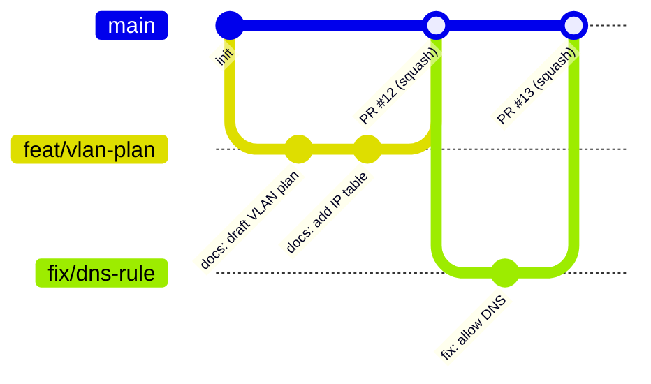

# 11 — Professional Workflow on GitHub

This is the **recommended day-to-day workflow** — and how most modern teams work. `sa-handbook` itself follows it.

## 1. Branching model: GitHub Flow



Rules:

1. `main` is **always** in a good, deployable state.
2. Every change starts as a **short-lived branch** from `main` (hours to a few days).
3. Changes reach `main` **only via Pull Request**, after checks pass.
4. Merge, then delete the branch.

**Other models you will meet:**

| Model | Idea | When |
|-------|------|------|
| **GitHub Flow** | `main` + feature branches | Most web/infra teams; continuous delivery |
| **Trunk-based** | Everyone commits to `main` (or branches < 1 day) + feature flags | High-maturity teams with strong CI |
| **GitFlow** | `main`, `develop`, `feature/*`, `release/*`, `hotfix/*` | Versioned products with scheduled releases; considered heavy today |
| **Release branches** | GitHub Flow + `release/x.y` for maintained versions | Software with several supported versions |

## 2. The full cycle

```text
 ┌─────────┐   ┌──────────┐   ┌──────────┐   ┌──────┐   ┌────────┐   ┌───────┐   ┌──────────┐
 │  Issue  │──▶│  Branch  │──▶│ Commits  │──▶│  PR  │──▶│ Review │──▶│ Merge │──▶│ Clean up │
 └─────────┘   └──────────┘   └──────────┘   └──────┘   │  + CI  │   └───────┘   └──────────┘
                                                        └────────┘
```

| Step | What you do | Commands |
|------|-------------|----------|
| 1. Issue | Describe the problem/task, add labels + milestone | `gh issue create` |
| 2. Branch | From fresh `main`, named `<type>/<desc>` | `git switch main && git pull && git switch -c feat/x` |
| 3. Commits | Small, focused, Conventional Commit messages | `git add -p && git commit` |
| 4. Push + PR | Fill the PR template, link the issue (`Closes #N`) | `git push -u origin feat/x && gh pr create` |
| 5. Review + CI | Address comments with new commits; keep CI green | `git commit … && git push` |
| 6. Merge | **Squash and merge**, PR title = final commit message | `gh pr merge --squash --delete-branch` |
| 7. Clean up | Update local main, delete local branch | `git switch main && git pull && git branch -d feat/x` |

## 3. Conventional Commits

Specification: <https://www.conventionalcommits.org/>

```text
<type>(<optional scope>)<optional !>: <description>

<optional body>

<optional footer(s)>
```

| Type | Meaning | Example |
|------|---------|---------|
| `feat` | New capability | `feat(terraform): add proxmox VM module` |
| `fix` | Bug fix | `fix(opnsense): allow NTP from server VLAN` |
| `docs` | Documentation only | `docs(adr): add ADR-0003 firewall choice` |
| `style` | Formatting, no logic change | `style: run terraform fmt` |
| `refactor` | Restructure, no behaviour change | `refactor(ansible): split opnsense role` |
| `perf` | Performance | `perf(ansible): cache apt packages` |
| `test` | Tests | `test(policy): add conftest cases` |
| `build` | Build system / dependencies | `build: pin terraform 1.9` |
| `ci` | CI configuration | `ci: add terraform plan workflow` |
| `chore` | Maintenance | `chore: update pre-commit hooks` |
| `revert` | Revert a commit | `revert: feat(vlan): add IoT VLAN` |

**Breaking change:**

```text
feat(network)!: renumber server VLAN from 10.10.20.0/24 to 10.10.30.0/24

BREAKING CHANGE: all static IPs on the server VLAN must be updated.
```

**Writing good descriptions:** imperative mood ("add", not "added"), lower-case, no period,
≤ 72 characters, explain *what*; the body explains *why*.

**Scopes** name the area that changed. Typical examples: `adr`, `design`, `security`, `git`,
`proxmox`, `terraform`, `ansible`, `github`, `ci`. Keep a short, stable list per repository and
write it in `CONTRIBUTING.md`.

## 4. Pull requests

**A good PR:**

- Does **one thing**; ideally < 400 changed lines.
- Has a Conventional Commit **title** (it becomes the squash commit message).
- Explains **what, why, how tested**, and links the issue (`Closes #12`).
- Includes screenshots / `terraform plan` output where useful.
- Is opened as **Draft** while work is in progress.

**Keywords that close issues on merge:** `Closes #12`, `Fixes #12`, `Resolves #12`.

**Reviewing (as a reviewer):**

| Look for | Questions |
|----------|-----------|
| Correctness | Does it do what the issue asks? Edge cases? |
| Design | Does it fit the architecture? Need an ADR? |
| Security | Secrets? Least privilege? New exposure? |
| Operability | Monitoring, backups, runbook impact? |
| Readability | Will someone understand this in 6 months? |

Review comment prefixes help: `nit:` (optional), `question:`, `suggestion:`, `blocking:`.

**Review states:** *Comment*, *Approve*, *Request changes*.
GitHub does not let you approve your own PR — in a solo repo, self-review the diff carefully.

## 5. Protecting main: rulesets / branch protection

*Settings → Rules → Rulesets → New branch ruleset* (target: `main`).

> ⚠️ **Plan limits:** on **GitHub Free**, rulesets and branch protection are enforced on
> **public** repositories only. Private repositories need GitHub Pro/Team/Enterprise. In a free
> private repo, use local hooks (`no-commit-to-branch`, see [10](10-advanced.md#git-hooks)) and
> team discipline instead.

| Rule | Effect |
|------|--------|
| Restrict deletions | `main` cannot be deleted |
| Block force pushes | No history rewriting on `main` |
| Require a pull request before merging | No direct pushes |
| Required approvals (team: ≥ 1) | Peer review (set 0 in a solo repo) |
| Require review from Code Owners | Owners of touched paths must approve |
| Require status checks to pass | CI must be green |
| Require conversation resolution | All review threads resolved |
| Require linear history | Only squash/rebase merges |
| Require signed commits | Only verified commits |

## 6. CODEOWNERS

Example: [`.github/CODEOWNERS`](../.github/CODEOWNERS). Maps paths to owners; GitHub
**automatically requests their review** on PRs touching those paths. With the ruleset option
*Require review from Code Owners*, their approval becomes mandatory.

```text
# Later, more specific rules override earlier ones
*                       @fridayn8
/terraform/             @example-org/platform-team
/adr/                   @example-org/architects
/security/              @example-org/security
/.github/workflows/     @example-org/platform-team @example-org/security
```

Syntax is like `.gitignore`; owners are users (`@name`), teams (`@org/team`) or emails.
The **last matching line wins**.

## 7. Labels, milestones, projects

| Tool | Suggested use |
|------|------------------|
| **Labels** | Type (`docs`, `feat`, `fix`, `security`) + area (`area:git`, `area:templates` …) |
| **Milestones** | One per release or learning goal: "v1.0" |
| **Projects** | Kanban board: Backlog → Ready → In progress → In review → Done |
| **Issue templates** | Task and Bug — see [`.github/ISSUE_TEMPLATE/`](../.github/ISSUE_TEMPLATE/) |

## 8. Merge strategies on GitHub

| Strategy | Result on `main` | Pros | Cons |
|----------|------------------|------|------|
| **Merge commit** | All branch commits + merge commit | Full history | Noisy graph |
| **Squash and merge** ← *recommended* | One commit per PR | Clean, 1 PR = 1 commit, easy revert | Loses individual commits |
| **Rebase and merge** | Branch commits replayed linearly | Linear, keeps commits | Every commit must be clean |
