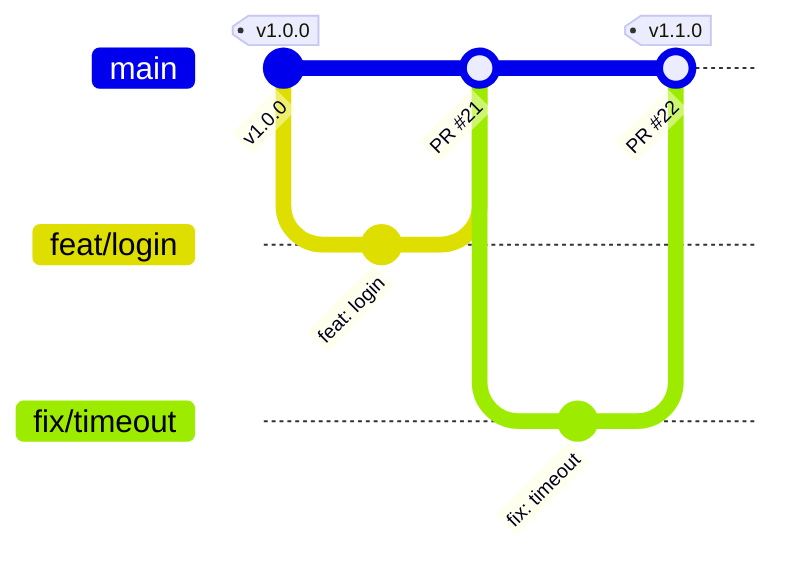
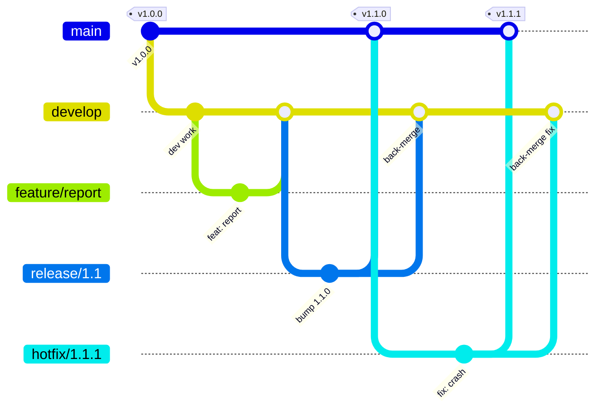
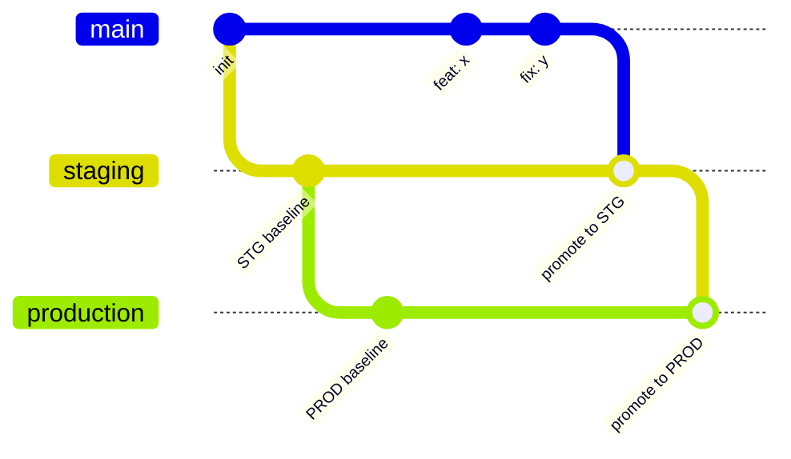
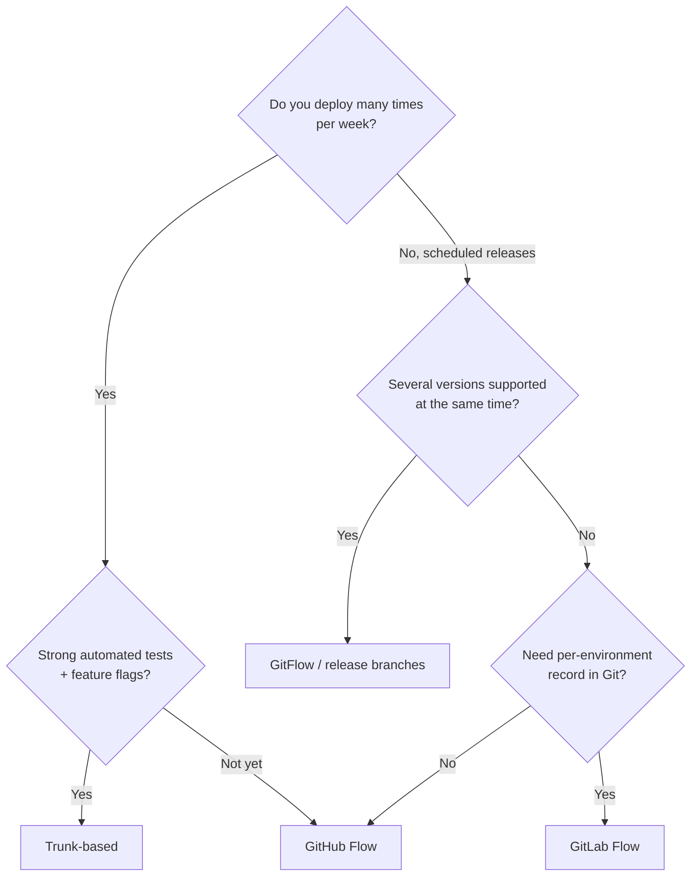
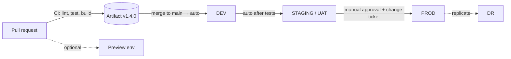

# 14 — Branching Strategies, Environments and Release Flow

How professional teams organise **branches**, **environments** (DEV → PROD) and **releases**,
and how Dev and Ops connect. Terms in **bold** are explained in the
[glossary](../architecture/glossary.md); the delivery lifecycle and term chains are in
[lifecycle and term chains](../architecture/lifecycle-and-term-chains.md).

## 1. `main` vs `master` (and `trunk`)

| Name | Origin | Today |
|------|--------|-------|
| `master` | Git's original default branch name | Still found in older repos and tutorials |
| `main` | Default for new repos on GitHub (since Oct 2020), GitLab and Bitbucket; Git ≥ 2.28 lets you set it with `init.defaultBranch` | **The modern standard** — used by `sa-handbook` |
| `trunk` / `mainline` | Term from SVN and from *trunk-based development* | Used as a *concept*: "the one shared integration branch" |

**They are functionally identical** — just a name for the primary, long-lived branch that
represents the latest integrated (and usually releasable) state of the project.

**Renaming `master` → `main` in an existing repo:**

```bash
# Owner, once
git branch -m master main
git push -u origin main
# GitHub: Settings → General → Default branch → main  (also retargets open PRs)
git push origin --delete master

# Every other clone
git fetch origin
git branch -m master main
git branch -u origin/main main
git remote set-head origin -a
```

Also update CI files, branch rulesets, docs and badges that mention `master`.

## 2. Branch types

| Branch | Lifetime | Purpose | Created from | Merged into | Strategy |
|--------|----------|---------|--------------|-------------|----------|
| `main` (`master`) | Permanent | Latest integrated, releasable code. In GitFlow: only released code | — | — | All |
| `develop` (`dev`) | Permanent | Integration of finished features for the *next* release | `main` | `release/*` | GitFlow |
| `feature/*` (`feat/*`) | Hours–days | One new capability | `main` or `develop` | Same | All |
| `bugfix/*` (`fix/*`) | Hours–days | Non-urgent bug fix | `main` or `develop` | Same | All |
| `release/x.y` | Days–weeks | Stabilise a version: only fixes, version bump, release notes | `develop` (or `main`) | `main` + back to `develop` | GitFlow, release branching |
| `hotfix/x.y.z` | Hours | **Urgent** fix for production | `main` / production tag | `main` + `develop` (or cherry-pick) | GitFlow, all in practice |
| `support/x.y` | Months–years | Maintain an old major version | Old tag | — (receives cherry-picks) | Products with LTS versions |
| `staging`, `production` | Permanent | Each branch = what is deployed in that environment | `main` | Next env branch | GitLab Flow (env branches) |
| `docs/*`, `chore/*`, `ci/*`, `refactor/*` | Hours–days | Non-feature work, named after Conventional Commit type | `main` | `main` | GitHub Flow |
| `spike/*`, `poc/*`, `experiment/*` | Days | Throw-away exploration | `main` | Usually **never** merged | All |

**Long-lived vs short-lived:** long-lived branches (`main`, `develop`, env branches) need
protection rules; short-lived ones should be merged and deleted fast — the longer a branch
lives, the bigger and riskier the merge ("merge hell").

## 3. Branching strategies

### 3.1 GitHub Flow — *the recommended default*



- One long-lived branch (`main`) + short-lived branches + PRs.
- Every merge to `main` can be deployed (often automatically to staging, then promoted).
- **Choose when:** small/medium team, continuous delivery, web services, infra repos.

### 3.2 GitFlow



- `main` = production history only (every commit is a tagged release); `develop` = next release.
- `release/*` freezes scope for testing; `hotfix/*` patches production.
- **Choose when:** scheduled releases (e.g. monthly), several versions in the field,
  mobile/desktop/on-prem products, strong QA/UAT gate. **Avoid** for continuous deployment —
  it adds overhead and long-lived branches.

### 3.3 GitLab Flow (environment branches)



- `main` → `staging` → `production`; promotion = merging downstream. Fixes go to `main`
  first, then flow down (*upstream first*).
- **Choose when:** you need a visible record of what is in each environment and cannot deploy
  on every merge (e.g. app-store review, fixed deployment windows).
- **Downside:** environment branches drift; modern CI/CD usually prefers **promoting the same
  artifact** (see §5) instead of merging branches.

### 3.4 Trunk-based development

- Everybody integrates into `main` (trunk) at least daily; branches live < 1 day or don't exist.
- Unfinished work is hidden behind **feature flags**; releases are cut from trunk (optionally
  with short `release/*` branches).
- **Choose when:** mature team with strong automated tests and CI — used by many large tech
  companies. Highest delivery speed; demands discipline.

### 3.5 Comparison and decision guide

| | GitHub Flow | GitFlow | GitLab Flow | Trunk-based |
|---|---|---|---|---|
| Long-lived branches | `main` | `main`, `develop` (+ release/support) | `main` + env branches | `main` |
| Complexity | Low | High | Medium | Low (process), high (discipline) |
| Release cadence | Continuous | Scheduled | Per environment | Continuous |
| Needs strong CI/tests | Yes | Less | Yes | **Very** |
| Hotfix path | Normal PR (fast) | `hotfix/*` | Fix in `main`, cherry-pick down | Normal commit + flag |
| Typical fit | Web apps, infra-as-code, SaaS | Versioned products, mobile, on-prem | Regulated or gated deployments | High-performing product teams |



## 4. Environments

An **environment** is a complete, isolated copy of the system used for one stage of the
delivery process.

| Env | Full name | Purpose | Used by | Data | Stability |
|-----|-----------|---------|---------|------|-----------|
| **LOCAL** | Local development | Write and run code on a laptop | Developer | Fake / seed | Unstable |
| **DEV** | Development | First shared deployment; integrate everyone's work | Developers | Fake | Can break often |
| **SIT** | System Integration Testing | Test integration with other systems / APIs | Developers, QA | Test data | Moderate |
| **QA / TEST** | Quality Assurance | Functional, regression and automated testing | QA engineers | Test data | Moderate |
| **UAT** | User Acceptance Testing | Business users confirm it meets requirements → **sign-off** | Business users, product owner | Masked prod-like | Stable |
| **STG / Staging / Pre-prod** | Staging (pre-production) | Final rehearsal: same config, size and process as PROD | Ops, QA, release manager | Prod-like (masked) | Very stable |
| **PROD** | Production | The live system real users depend on | End users | Real | Must be stable |
| **DR** | Disaster Recovery | Standby copy to take over if PROD fails | Ops (during a disaster) | Replica of PROD | Standby |
| **Preview / Ephemeral** | Per-PR temporary environment | Review a PR in a running system; destroyed after merge | Reviewers | Fake | Throw-away |

Small teams often collapse these into **DEV → STG → PROD** (this lab: **LAB → PROD**).

**Principles**

- **Build once, deploy many:** build the artifact (container image, package, VM template)
  *once*, then promote the **same** artifact through environments. Only configuration differs.
- **Environment parity:** STG should mirror PROD (versions, topology, config) — "works in
  staging" must mean something.
- **Configuration per environment** lives outside the artifact (env vars, `tfvars`, secrets
  manager), never as code branches.
- **Production data never goes to lower environments unmasked** (privacy/compliance).
- **Access narrows towards PROD:** everyone can deploy to DEV; only the pipeline (with approval)
  deploys to PROD.

## 5. Mapping branches and environments



| Strategy | What triggers deployment to … | DEV | STG / UAT | PROD |
|----------|-----------------------------|-----|-----------|------|
| GitHub Flow | Merge / tag | Merge to `main` | Automatic after DEV tests | Tag `v*` or manual approval |
| GitFlow | Branch | `develop` | `release/*` | Merge to `main` + tag |
| GitLab Flow | Branch | `main` | `staging` | `production` |
| Trunk-based | Pipeline stage + flags | Every commit | Automatic | Automatic or approval; features toggled by flags |

**For Infrastructure as Code**, environments are **folders, not branches**:

```text
terraform/envs/
├── lab/       # practise environment (nested Proxmox on laptop)
└── prod/      # example only — same modules, different tfvars
```

One PR changes a module → CI runs `terraform plan` for **each** environment → apply to `lab`
after merge → apply to `prod` after approval. Branch-per-environment for IaC causes drift and
painful merges, so it is avoided.

## 6. Deployment strategies (how a release reaches users)

| Strategy | How it works | Downtime | Rollback | Cost | Use when |
|----------|--------------|----------|----------|------|----------|
| **Recreate / big-bang** | Stop old, start new | Yes | Redeploy old (slow) | Low | Maintenance window acceptable, stateful single server |
| **Rolling** | Replace instances one by one | No | Roll back gradually | Low | Several identical instances behind a load balancer |
| **Blue-green** | Two identical stacks; switch traffic from blue (old) to green (new) | No | Switch back instantly | 2× resources during switch | Need instant rollback |
| **Canary** | Send a small % of traffic (1 → 10 → 50 → 100 %) to the new version while watching metrics | No | Stop the canary | Medium | High-traffic systems, risky changes |
| **Feature flags / dark launch** | Code deployed but switched off; enable per user/group | No | Turn flag off | Low (+ flag tool) | Decouple deploy from release; trunk-based |
| **A/B testing** | Two variants to measure user behaviour | No | — | Medium | Product experiments (business, not safety) |
| **Shadow / mirroring** | Copy live traffic to new version, discard its responses | No | — | High | Test performance with real traffic |

**Deploy ≠ release:** *deploy* = put code on servers; *release* = make it available to users.
Feature flags and blue-green separate the two.

**Rollback vs roll-forward:** rollback returns to the previous version (fast, needs
backward-compatible data); roll-forward ships a new fix quickly. Database migrations should be
backward compatible (*expand → migrate → contract*) so rollback stays possible.

## 7. The Ops side: release and change management

In companies — especially with ITIL-style IT service management — production changes follow
a **change management** process:

| Step | What happens | Terms |
|------|--------------|-------|
| 1. Request | Create a change ticket describing what, why, risk, test evidence, **rollback plan**, schedule | **RFC**, change request, CR |
| 2. Classify | **Standard** (pre-approved, low risk), **Normal** (needs approval), **Emergency** (urgent, fast-track) | Change types |
| 3. Approve | Reviewed by change manager or **CAB**; emergency by **ECAB** | CAB, ECAB |
| 4. Schedule | During a **maintenance window**, not during a **change freeze** | Change window, freeze, blackout period |
| 5. Go / No-Go | Final check just before the change: tests passed, people available, rollback ready | Go/No-Go meeting |
| 6. Implement | Deploy / **cutover** following the runbook | Cutover plan, runbook |
| 7. Verify | **Smoke test**, monitoring, business verification | Smoke test, sanity check |
| 8. Close / hypercare | Close the ticket; intensive monitoring for days after big go-lives | Hypercare, PIR |

How it connects to Git:

- The **PR** is the technical evidence (diff, review, CI results); link it in the RFC.
- The **tag** (`v1.4.0`) identifies exactly what was deployed.
- **Standard changes** are often fully automated: merged PR + green pipeline = approved.
- Modern DevOps aims to make most changes *standard* through automation and small batches.

## 8. Scenarios step by step

### A. Normal feature (GitHub Flow)

```bash
gh issue create --title "feat(app): export report as CSV"         # 1. plan
git switch main && git pull && git switch -c feat/report-csv       # 2. branch
git commit -m "feat(app): export report as CSV"                    # 3. work
git push -u origin feat/report-csv && gh pr create                 # 4. PR → CI + preview env
gh pr merge --squash --delete-branch                               # 5. review OK → merge
# 6. pipeline: build artifact → deploy DEV → tests → deploy STG/UAT
# 7. UAT sign-off → approval in pipeline (standard change) → deploy PROD → smoke test
git tag -a v1.5.0 -m "Release 1.5.0" && git push origin v1.5.0    # 8. tag (or release-please)
```

### B. Scheduled release (GitFlow)

```bash
git switch develop && git pull
git switch -c release/1.5                    # scope frozen; only fixes from now
# fix bugs found in UAT on release/1.5, bump version, write release notes
git switch main && git merge --no-ff release/1.5
git tag -a v1.5.0 -m "Release 1.5.0" && git push origin main v1.5.0     # → PROD (CAB-approved)
git switch develop && git merge --no-ff release/1.5 && git push         # back-merge fixes
git branch -d release/1.5 && git push origin --delete release/1.5
```

### C. Production hotfix (incident)

```bash
# SEV1 incident: users cannot log in after v1.5.0
git switch -c hotfix/1.5.1 v1.5.0            # branch from what is IN production
git commit -m "fix(auth): handle expired session tokens"
git push -u origin hotfix/1.5.1 && gh pr create --base main --label hotfix
# fast review + CI → emergency change (ECAB) → merge → tag v1.5.1 → deploy → verify
# GitFlow: also merge hotfix into develop; GitHub Flow: it's already on main
# afterwards: postmortem + RCA, add a test so it cannot happen again
```

### D. Rollback

```bash
# Option 1 — redeploy the previous artifact/tag (fastest, no Git change needed)
#   e.g. pipeline "deploy" with version = v1.4.0
# Option 2 — revert in Git, so main reflects reality
git switch -c revert/v1.5.0 main
git revert --no-edit <merge-sha>             # or the squash commit of the PR
gh pr create --title "revert: feat(app): export report as CSV"
```

### E. Infrastructure change (example)

```text
feat/opnsense-iot-vlan branch
  → PR: pre-commit, tflint, Checkov, `terraform plan` (lab) posted as PR comment
  → review the plan: only expected resources change?
  → squash merge → pipeline applies to LAB → verify (ping, firewall logs)
  → (in a company) RFC with plan output + rollback plan → apply to PROD in the change window
```

## 9. Recommended defaults

The convention this handbook recommends. `sa-handbook` itself follows it.

| Topic | Choice |
|-------|--------|
| Primary branch | `main` |
| Strategy | GitHub Flow |
| Branch names | `<conventional-type>/<description>` |
| Merge method | Squash and merge |
| Environments | `lab` (and an example `prod`) as Terraform folders, not branches |
| Releases | SemVer tags, optionally automated with release-please |
| Hotfix | Normal short-lived `fix/*` branch with high priority |
