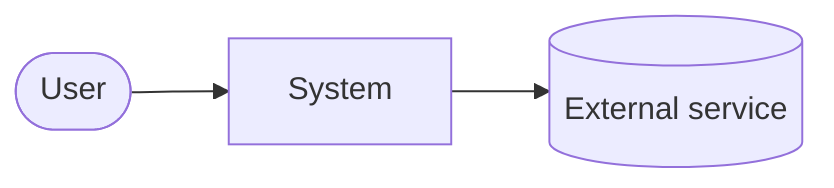

# High-Level Design — {System name}

<!-- The HLD is the big picture: what is built, from which parts, how they interact and why.
     Details such as IP addresses, sizes and rule lists belong in the LLD.
     Replace every {placeholder}, delete the comments and the example. -->

| | |
|---|---|
| **Document** | High-Level Design |
| **Version** | 0.1 (draft) |
| **Status** | Proposed |
| **Owner** | {name or role} |
| **Related** | Requirements · ADRs · LLDs |

## 1. Purpose and scope

{What this design covers and what it does not. Link the requirements document.}

## 2. Architecture summary

{One paragraph a manager can read: the solution in plain words, with the context diagram.}

## 3. Key architecture decisions

| Decision | Chosen | Reason | ADR |
|----------|--------|--------|-----|
| {topic} | {option} | {one line} | ADR-NNNN |

## 4. Logical components

| Component | Responsibility | Technology |
|-----------|----------------|------------|
| {name} | {what it does} | {product or tool} |

## 5. Access and traffic flows

<!-- One short subsection per flow: who, from where, through what, to what, with which control. -->

### 5.1 {Flow name}

{Numbered steps or a sequence diagram.}

## 6. Security architecture

{Trust boundaries, authentication and authorisation, encryption, secrets, logging. Link the
threat model.}

## 7. Operations: monitoring, backup and recovery

{What is monitored, who is alerted, backup scheme and recovery targets (RTO and RPO).}

## 8. Non-functional requirements — how they are met

| NFR | How the design meets it |
|-----|-------------------------|
| NFR-01 | {design element} |

## 9. Risks and open issues

| # | Risk or open issue | Impact | Mitigation or next step |
|---|--------------------|--------|-------------------------|
| R1 | {risk} | {H/M/L} | {action} |

## 10. Transition from current state

{As-is to to-be: order of work, migration, cut-over, rollback.}

## 11. Related documents

- {links}

## Example (delete before use)

| Decision | Chosen | Reason | ADR |
|----------|--------|--------|-----|
| Remote access | Zero Trust proxy, no inbound ports | Removes port-forwarding exposure | ADR-0005 |
